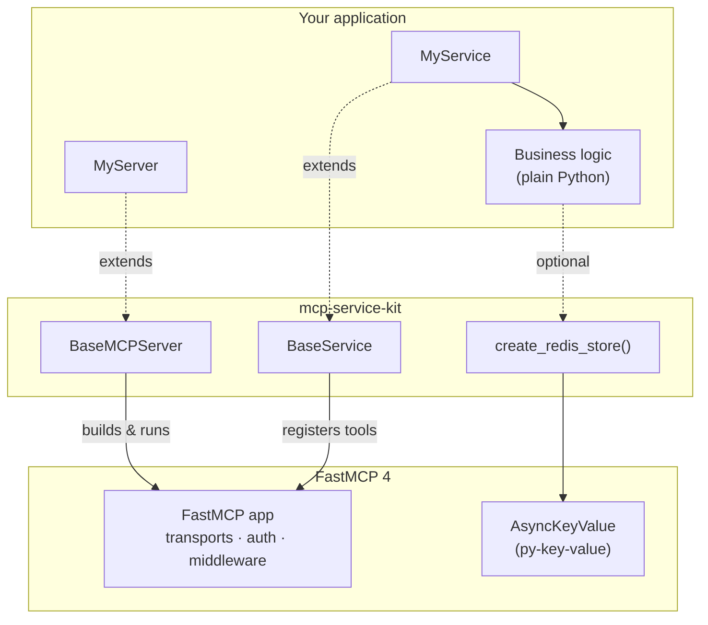
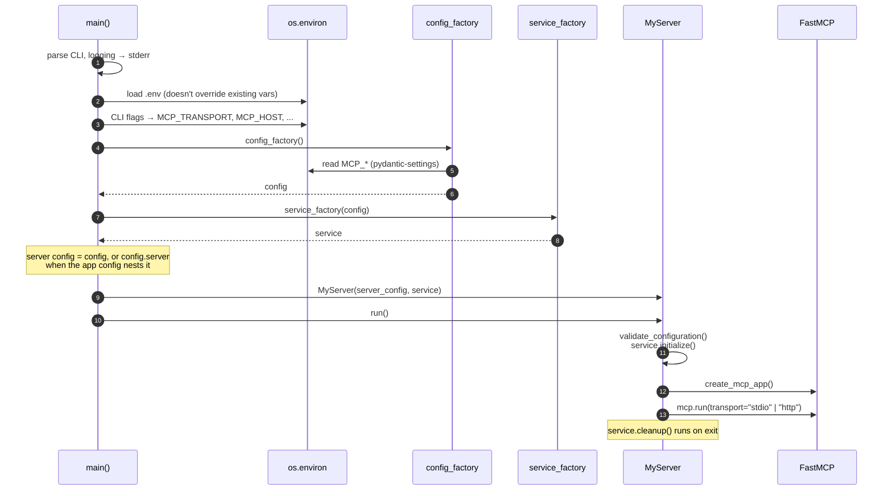
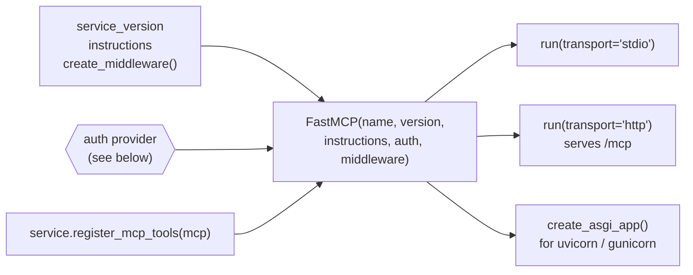
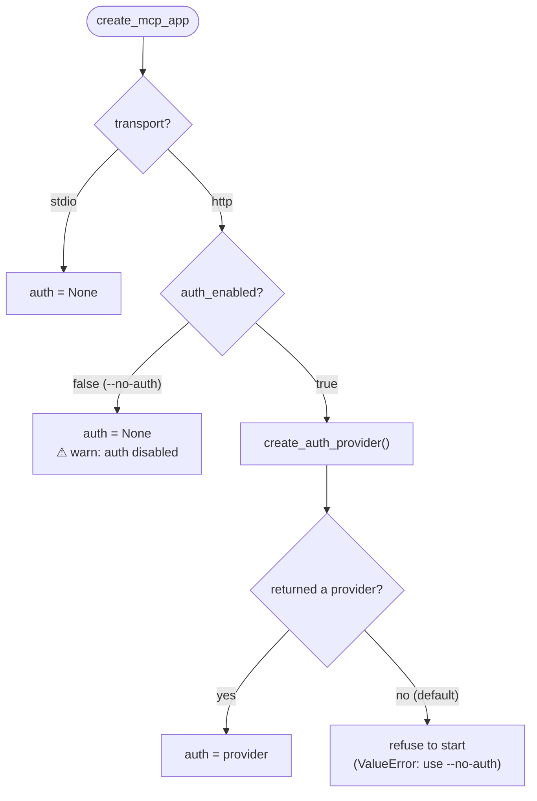
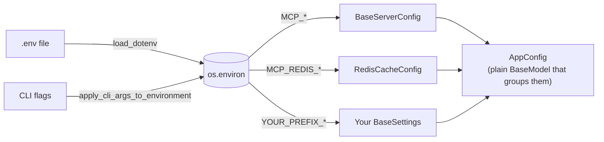
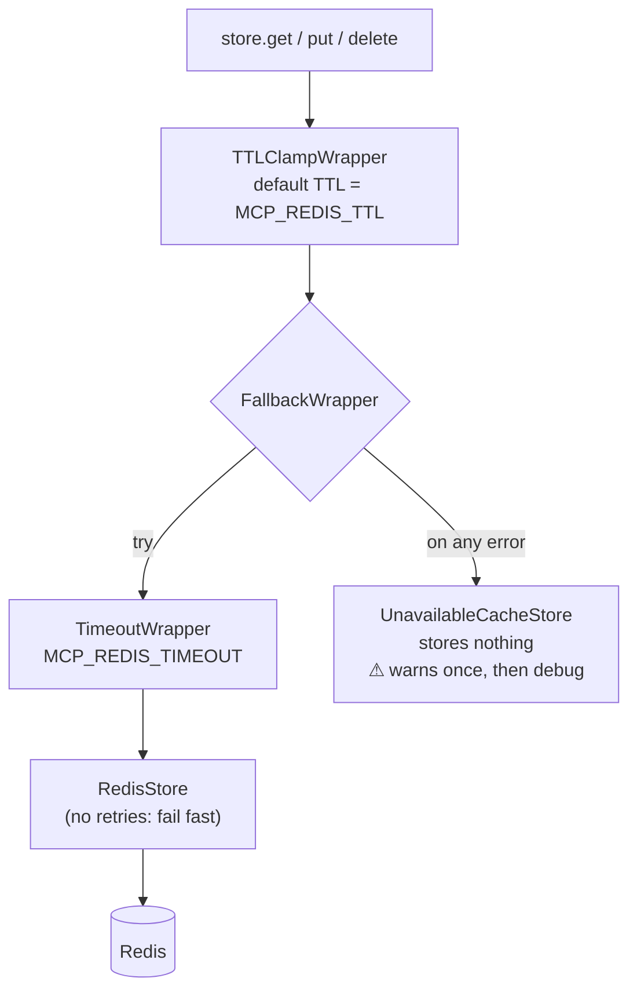

# Architecture

mcp-service-kit is a thin layer over [FastMCP](https://gofastmcp.com). FastMCP does the
protocol, transports and auth. The kit adds a fixed shape for a server: a split between
service and server, configuration from the environment, a standard CLI, and an optional
cache that keeps working when Redis is down. This page explains how those pieces fit
together and why.

## Layers

Each layer has one job:

| Piece | Owns | Doesn't know about |
|---|---|---|
| Business logic | What the tools do | MCP, transports |
| `BaseService` | Registering tools on a `FastMCP` instance | Transport, auth, config loading |
| `BaseMCPServer` | Building the FastMCP app and choosing the transport | What the tools do |
| `create_main_with_modes()` | CLI, logging, `.env`, wiring the objects together (see [Startup](#startup)) | Anything app-specific |

Keeping tool registration in the service and transport in the server means the same
service runs over stdio, HTTP, or in memory in tests (`fastmcp.Client(mcp)`) without changes.

## Startup

`create_main_with_modes()` returns a `main()` that runs the steps below in order. The
order matters in three places:

- Logging goes to **stderr** before anything else logs, so the stdio protocol stream on
  stdout stays clean.
- `.env` is loaded before the CLI flags are written to the environment, so flags win over
  `.env`.
- Config is read only after both, so a single instantiation sees the final values.

The whole config object goes to the service factory, but only its `server` section goes to
the server. The service gets everything it needs, such as API keys and cache settings,
while the server sees only transport settings.

## Building the FastMCP app

`create_mcp_app()` is where the server's hooks come together. The hooks are plain methods
with safe defaults, so a subclass only overrides what it needs.

### Auth decision

Auth only means something over HTTP. The kit doesn't include an identity provider: it asks
the subclass for any FastMCP `AuthProvider` (for example `JWTVerifier`) and passes it
through unchanged.

HTTP fails closed. If auth is on but there's no provider, the server doesn't start, so it
never serves its tools without auth by accident. Serving without auth has to be asked for
with `--no-auth`.

The hook is never called for stdio, so a provider that needs network access or secrets
doesn't affect local runs.

## Configuration

Each config class is a pydantic-settings model with its own env prefix. Instantiating one
reads the environment, and its type annotations do the validation. For example, a bad
`MCP_TRANSPORT` fails at startup.

Everything passes through `os.environ` rather than through arguments. The CLI, `.env` and a
deployment's real environment are then three ways of setting the same variables, and the
config classes work the same with or without the CLI. That covers tests, `create_asgi_app()`
and scripts.

## Cache

`create_redis_store()` doesn't wrap Redis in a custom client. It returns py-key-value's
`AsyncKeyValue`, the storage interface FastMCP itself uses, with wrappers that make Redis
optional at runtime:

How it behaves:

- **Redis healthy:** a normal Redis cache.
- **Redis down or slow:** reads return `None` and writes are dropped. The caller's
  cache-miss path runs, so the tool still answers, just uncached. Retries are off so a
  dead Redis doesn't add backoff to every call. The timeout covers slow responses.
- **Same interface everywhere:** the store can be used directly in business logic, or passed
  to FastMCP's `ResponseCachingMiddleware` through `create_middleware()` to cache whole tool
  results.

Importing `mcp_service_kit.cache` without the `[redis]` extra raises an `ImportError`
explaining how to install it. The core package never imports it, so the base install
doesn't need Redis.

## Design rules

- **No side effects on import.** Logging setup, `.env` loading and env writes happen only
  inside `main()`.
- **Hooks over abstract methods.** Only `service_title`, `service_description` and
  `service_version` are required. Everything else has a safe default.
- **FastMCP does the protocol work.** Transports, auth and middleware are FastMCP's own. The
  kit chooses and wires them but doesn't reimplement them.
- **stdout belongs to the protocol.** Nothing in the kit writes to stdout.
